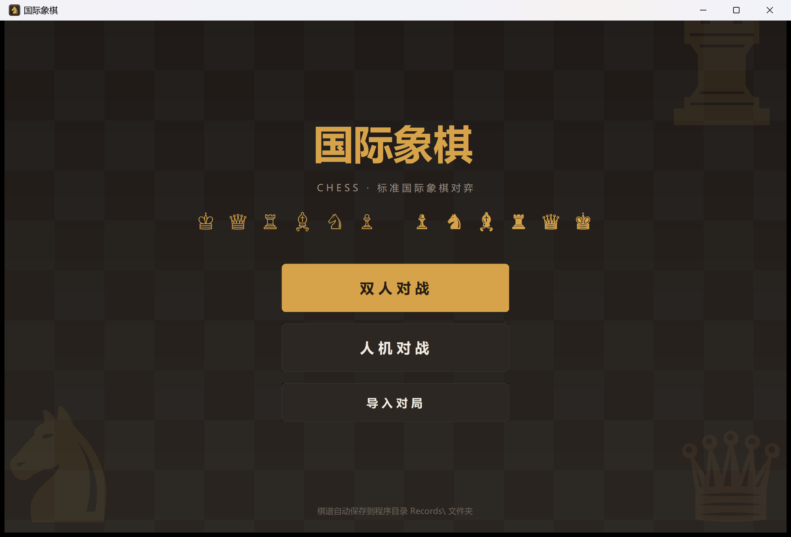

# Blob的国际象棋

一个用 C# / .NET 10 + Windows Forms 写的完整国际象棋程序。棋子用 Unicode 国际象棋字符绘制，
包含双人对战、三档人机对战、棋谱保存与导入回放，全部在**同一个窗口**内完成。



## 功能

- **单窗口**：主菜单、难度选择、对局 / 回放都是同一窗口内的页面切换，支持缩放与最大化。
- **人机对战**：简单 / 普通 / 困难三档，分别是 2 / 4 / 6 层 Alpha-Beta 搜索，带静态搜索与走法排序。
  电脑走子前固定等待 3 秒（与搜索并行，不叠加）。
- **严格规则**：吃过路兵、王车易位（含被将军限制）、兵升变、将杀、逼和、五十步、三次重复、子力不足。
- **动画**：走子与吃子都是 0.28 秒滑行，被吃子撑到吃子落地才消失。
- **棋谱**：每局在程序目录 `Records\` 下生成 `YYYY_MM_DD_流水号.rcd`（标准 PGN），
  带 `[Mode "n"]` 模式标记（0 双人 / 1 简单 / 2 普通 / 3 困难）。
- **导入回放**：读取任意 `.rcd`，点棋谱中任意一手即跳到该局面，支持逐步 / 自动播放。

## 目录

```
Chess/            源码（Chess.slnx + 项目）
Chess/Chess/      C# 工程：Core 规则引擎、Ai 搜索、Recording 棋谱、Ui 自绘控件
Chess-App/        打包：installer.iss、build-installer.ps1、dist 下的安装包与免安装包
```

详细说明见 [Chess/README.md](Chess/README.md)。

## 构建与运行

需要 .NET 10 SDK 与 Visual Studio 2026（或仅用 SDK 也可）。

```powershell
dotnet build Chess\Chess\Chess.csproj -c Release
dotnet run   --project Chess\Chess\Chess.csproj
```

运行需要 .NET 10 桌面运行时（Desktop Runtime）。

## 安装包

`Chess-App/dist/` 下有两份现成产物：

| 文件 | 说明 |
| --- | --- |
| `BlobChess-Setup-1.0.0.exe` | Inno Setup 安装包，默认装到 `%LOCALAPPDATA%\Programs\Blob的国际象棋` |
| `BlobChess-Portable-1.0.0.zip` | 免安装包，解压即用 |

重新打包：

```powershell
pwsh Chess-App\build-installer.ps1
```

要注意：**不要在工作区等带 `Everyone:(CI)(DENY)(DC)` 权限的目录里直接运行 Setup.exe**，否则会报
“无法创建临时目录 / Error 5”。把安装包复制到普通目录再运行，或用脚本先编译到 `%TEMP%` 再复制出来。

## 许可

[MIT](LICENSE)
